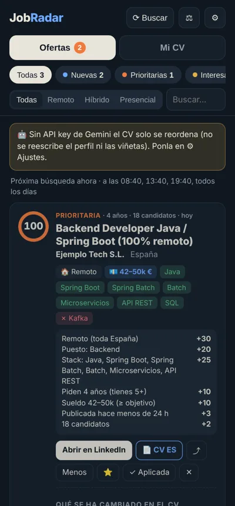
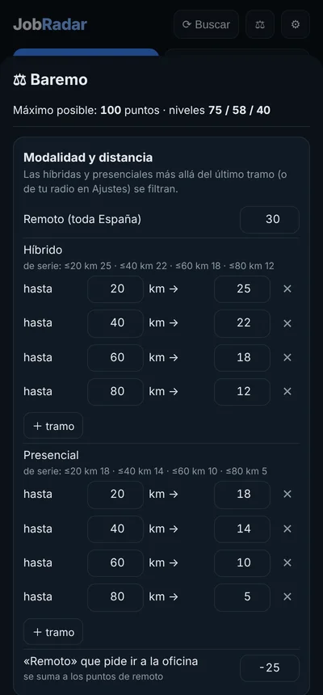
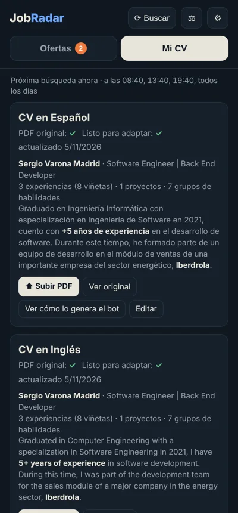

# JobRadar

Radar de **ofertas de empleo en LinkedIn** hecho a medida de mi perfil. Un servidor en Python en una Raspberry Pi busca en la búsqueda pública de LinkedIn cuando le digo y puntúa cada oferta de 0 a 100 según mis prioridades. Para las que encajan genera **un CV adaptado a esa oferta** y avisa a una app Android propia.

De momento no se postula solo: avisa, prepara el CV y la decisión es mía.

## Capturas

<p align="center">
  
  
  
</p>

## Qué hace

- **Busca** ofertas de programación y análisis **con cualquier lenguaje** en remoto en toda España, y ofertas híbridas o presenciales solo cerca de casa. El encaje con cada tecnología lo resuelve el CV adaptado, no el filtro.
  - Solo abre el detalle de las ofertas nuevas.
  - Antes descarta por título lo que no es programar ni analizar (QA, comercial, soporte, prácticas…) y el relleno que mete LinkedIn.
- **Puntúa** cada oferta y explica de dónde sale cada punto. Tiene en cuenta:
  - modalidad y distancia por carretera,
  - tipo de puesto,
  - encaje del stack,
  - experiencia pedida,
  - sueldo publicado frente a mi mínimo,
  - frescura y número de candidatos.

  También detecta las ofertas «remotas» que en realidad piden ir a la oficina.
- **El baremo se edita desde la app**: tramos de km, puntos por tecnología, umbrales de cada nivel… Al guardar, repuntúa las ofertas guardadas.
- **Adapta el CV a cada oferta**:
  - Gemini reescribe el perfil y reordena o reformula viñetas y habilidades.
  - Una **guarda determinista en Python** rechaza cualquier frase que nombre tecnologías, cifras o cargos que no estén en el CV original, y en ese caso deja la frase original.
  - El PDF es de una página, se genera con ReportLab y tiene el mismo estilo que el CV original.
  - Va en el idioma de la oferta. Sin IA, adapta por reglas.
- **Compara requisitos**: lista lo que pide cada oferta frente a lo que tiene el CV (✅ 🟡 ❌).
- **Frecuencia configurable**: a horas fijas o cada N horas dentro de una franja, eligiendo los días. Recupera las búsquedas perdidas si la Pi estuvo apagada.
- **Avisa al móvil** solo cuando el CV de la oferta está listo. La notificación lleva dos botones: *Abrir en LinkedIn* y *Ver CV*.
- **Avisa de las visitas al portfolio**, con un contador propio sin cookies ni servicios de terceros. La web avisa a la Pi a través de Tailscale Funnel y la notificación dice de dónde llega la visita. Si viene del enlace de un CV adaptado, dice a qué oferta se envió ese CV.
- **Se autovigila**: si LinkedIn limita las peticiones o cambia su HTML, corta la pasada, guarda la página para depurarla y lanza una alerta.

## Arquitectura

```
 LinkedIn (búsqueda pública, sin login)
                 │  pasadas programadas, con pausas
                 ▼
        Servidor Python (Raspberry Pi)
        ├─ lector de listado y detalle   (linkedin.py)
        ├─ baremo explicado + distancias (puntuar.py, geo.py)
        ├─ planificador de pasadas       (planificador.py)
        ├─ adaptación del CV + guarda    (cv.py) ── Gemini API
        ├─ PDF del CV                    (pdfcv.py, ReportLab)
        ├─ SQLite                        (db.py)
        ├─ API HTTP + panel web          (web.py, static/)
        └─ receptor de visitas /v        (visitas.py) ◄── portfolio (GitHub Pages) vía Tailscale Funnel
                 │  Tailscale (VPN)
                 ▼
          App Android (Kotlin)
          avisos por nivel · abrir y compartir el CV · subir el CV
```

## Tecnologías

- **Backend**: Python 3 con biblioteca estándar (`http.server`, `sqlite3`, `urllib`) más BeautifulSoup y ReportLab. Todo se instala desde apt, sin pip, para que corra ligero en una Raspberry Pi 3.
- **IA**: Gemini con salida JSON por esquema, validada en Python antes de usarla.
- **Tests**: `unittest`, que cubre el lector, el baremo, los sueldos, las distancias, la guarda del CV y el planificador.
- **App**: Android nativo en Kotlin (WebView, WorkManager y FileProvider).
- **CI/CD**: GitHub Actions compila y publica la APK en cada push.
- **Infraestructura**: servicio `systemd`, acceso solo por Tailscale y monitorizado con [Pi Monitor](https://github.com/svaronam/pi-monitor).

## Estructura

```
server/
  run.py                  servir · pasada · probar · cv · demo
  install.sh              paquetes de apt + servicio systemd
  jobradar/               código del servidor
  tests/                  tests y HTML de ejemplo
  data/                   CV, ofertas y ajustes (no se versiona)
android/                  app Android
.github/workflows/        compilación de la APK
```

## Puesta en marcha

Ver [INSTALACION.md](INSTALACION.md).
